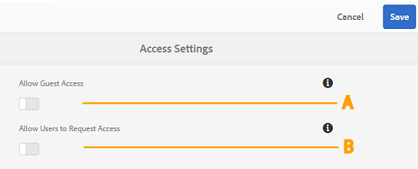

# Administrar el acceso de los usuarios en Brand Portal {#administer-user-access-on-brand-portal}

Adobe Experience Manager Assets Brand Portal 6.4.2 y versiones posteriores autoriza a los administradores a configurar el acceso de invitados y a permitir que los usuarios soliciten acceso desde el Brand Portal de su organización. Estas configuraciones se han proporcionado como **[!UICONTROL configuraciones de acceso]** en el panel administrativo. Ambos ajustes están desactivados de forma predeterminada.

**A**: configuración para permitir que los invitados tengan acceso en Brand Portal mediante el vínculo **[!UICONTROL `Guest Access?`]** en la pantalla de bienvenida de Brand Portal. (El valor predeterminado está desactivado)

**B**: configuración para permitir que los usuarios soliciten acceso a Brand Portal mediante el vínculo **[!UICONTROL `Need access?`]** en la pantalla de bienvenida de Brand Portal. (El valor predeterminado está desactivado)

## Permitir el acceso de invitados {#allow-guest-access}

Al permitir el acceso como invitado, los usuarios pueden acceder a los recursos públicos sin tener que iniciar sesión en Brand Portal.
Para permitir el acceso de invitados, el administrador debe realizar los siguientes pasos:

1. Seleccione el logotipo de AEM para acceder a las herramientas administrativas desde la barra de herramientas de la parte superior.
1. En el panel de herramientas administrativas, seleccione **[!UICONTROL Acceso]** para abrir la página **[!UICONTROL Configuración de acceso]**.
1. Habilite la configuración **[!UICONTROL Permitir el acceso de invitados]**.
1. **[!UICONTROL Guardar]** los cambios.
1. Cierre la sesión para que los cambios surtan efecto.

## Permitir a los usuarios que soliciten acceso {#allow-users-to-request-access}

Los administradores pueden permitir que los usuarios de la organización soliciten acceso a Brand Portal desde la pantalla de bienvenida. Sin embargo, los administradores deben habilitar la configuración **[!UICONTROL Permitir que los usuarios soliciten acceso]** para que el vínculo de solicitud de acceso aparezca en la pantalla de bienvenida.

Para permitir que los usuarios de la organización soliciten acceso en Brand Portal, los administradores deben:

1. Seleccione el logotipo de AEM para acceder a las herramientas administrativas desde la barra de herramientas de la parte superior.
1. En el panel de herramientas administrativas, seleccione **[!UICONTROL Acceso]** para abrir la página **[!UICONTROL Configuración de acceso]**.
1. Habilite la configuración **[!UICONTROL Permitir que los usuarios soliciten acceso]**.
1. **[!UICONTROL Guardar]** los cambios.
1. Cierre la sesión para que los cambios surtan efecto.
